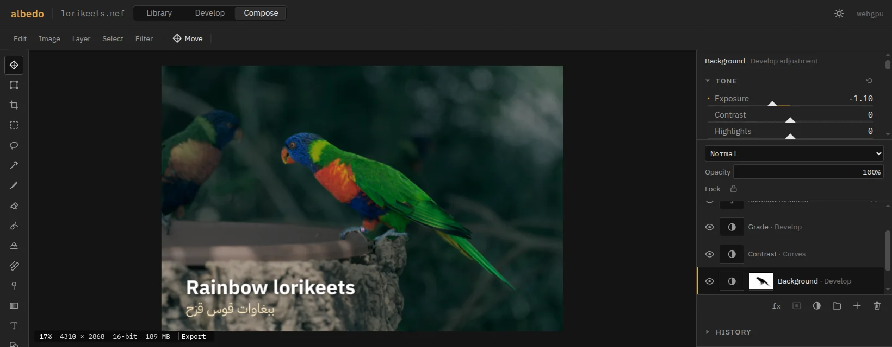
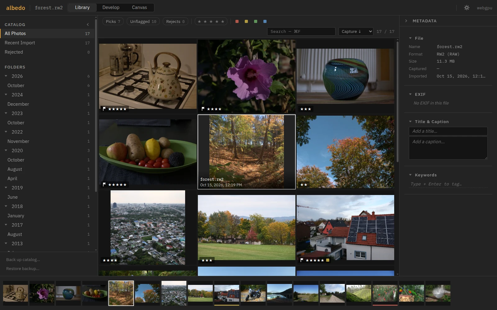
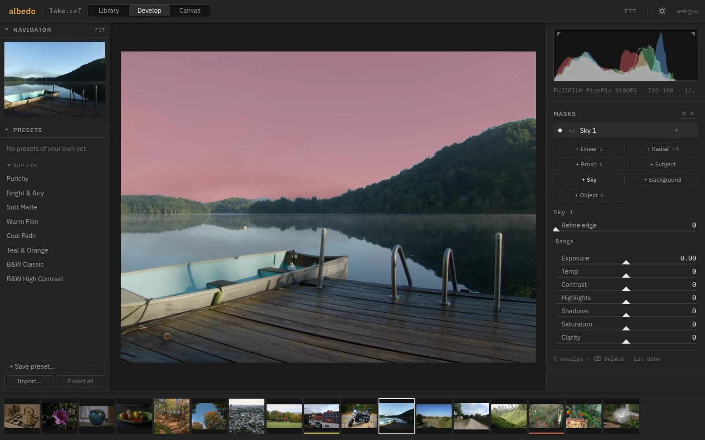
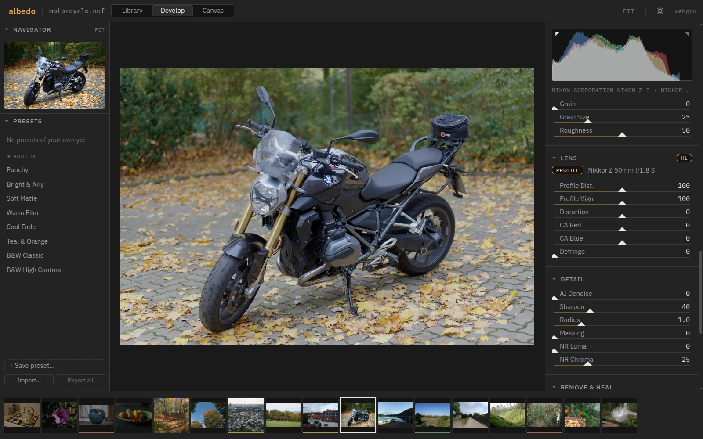
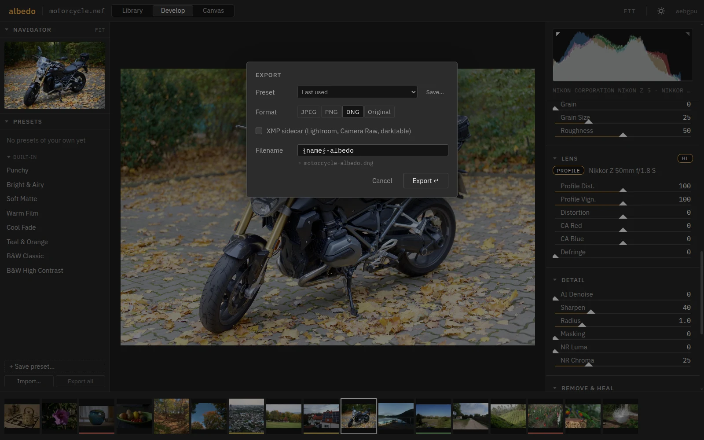

<p align="center"></p>

albedo is a RAW photo developer and layered editor that runs in the browser: catalog, cull, develop on the GPU, mask with local AI, then retouch and composite in layers with the RAW still inside. It exports JPEG, PNG, 16-bit TIFF, DNG, PSD or the original with an XMP sidecar. Installed, it works offline and opens files from the desktop.

<p align="center">
  
  
</p>
<p align="center">
  
  
</p>

The photos are CC0 samples from [raw.pixls.us](https://raw.pixls.us).

**[Open albedo](https://zahakj.github.io/albedo/app/)** · [Manual](https://zahakj.github.io/albedo/manual/)

## Run

```sh
git clone https://github.com/ZahakJ/albedo.git && cd albedo
npm install
npm run setup-models   # optional: AI masks, Remove, AI Denoise
npm run dev            # http://localhost:5180
```

`npm run build` writes a static site to `dist/` that any static file server can host, at a domain root or under a path; no special headers are needed.

## Use

- **Import**: drop files on the window or press `O`. CR2, CR3, NEF, ARW, RAF (Bayer and X-Trans), ORF, RW2, PEF, DNG and the other formats LibRaw reads, plus JPEG and PNG. Lightroom `.xmp` sidecars apply to their photos, other `.xmp` files become presets, `.dcp` files become camera profiles.
- **Library** (`G`): pick, reject, unflag (`P` `X` `U`), rate `0`–`5`, label `6`–`9`, search (`⌘F`). Albums, smart collections, a capture-date tree. `⇧C` culls full screen, `C` compares, `N` surveys.
- **Develop** (`D`): profile (AgX, linear or a DCP), white balance, tone, point curve, HSL mixer, B&W, three-way grading, clarity, texture, dehaze, vignette, grain, lens profile corrections, sharpening, wavelet or AI noise reduction; crop (`R`).
- **Masks** (`M`): linear, radial, brush, and AI subject, sky, background or object (`B`, click or drag a box), each refinable by luma and colour range.
- **Remove** (`Q`): paint over anything, or click an object, and it is filled from its surroundings. **Heal** (`H`): spot heal and clone.
- **Export** (`⌘E`): JPEG, PNG, 16-bit TIFF, DNG with the edit inside, or the original, each with an optional XMP sidecar that Lightroom, Camera Raw and darktable read.
- **Compose** (`E`, or `⌘⇧E` from Develop): layers at 8, 16 or 32 bits.
  - Layer types: RAW smart objects that stay re-developable; Develop and Photoshop-style adjustment layers; masks, clipping, groups, Blend If, the 27 blend modes, layer styles.
  - Selection: marquee, lasso, wand, colour range, AI subject, sky and object, refine edge.
  - Retouching: heal and clone, spot healing and content-aware fill (local, no credits), dodge and burn, frequency separation, liquify, perspective and warp.
  - Paint and type: brushes with pen pressure; type shaped by HarfBuzz, so Arabic and mixed-direction lines are right.
  - Files: PSD in and out, layered TIFF in.

`⌘K` opens the command palette; `?` lists every shortcut.

## How it works

Four workers keep the main thread free. The decode worker runs LibRaw compiled to WebAssembly and hands the raw mosaic to the render worker, which demosaics it on the GPU (RCD for Bayer sensors, a directional method for X-Trans), inpaints clipped highlights, applies the lens profile and camera colour, and runs the whole edit as fragment passes with the same math in WGSL and GLSL. The AI worker runs ONNX models through onnxruntime-web on WebGPU, and streams AI-denoised tiles straight to the render worker. The catalog worker keeps a SQLite database in the Origin Private File System beside every original, thumbnail, edit and mask. An edit is a small JSON document; export renders the original from it. Compose runs in the render worker so that it shares Develop's GPU device: a smart object is developed by Develop's own code, a Develop adjustment layer is the develop pass over the composite below it, and each frame is composited at the resolution of the screen.

## Documentation

- [Manual](https://zahakj.github.io/albedo/manual/)
- [Architecture](docs/ARCHITECTURE.md): threads, messages, state, source layout
- [Render pipeline](docs/PIPELINE.md): decode, demosaic, the develop pass, profiles, masks, removal, denoise, export
- [Catalog and storage](docs/CATALOG.md): SQLite schema, OPFS layout, the edit document
- [Presets and Lightroom XMP](docs/PRESETS.md): preset files, the XMP mapping in both directions
- [Models](docs/MODELS.md): the AI models, their sources and licenses
- [Benchmarks](docs/BENCHMARKS.md): speed against darktable and RawTherapee, memory, demosaic quality, a 10,000-photo catalog
- [Compose](docs/proposals/compose.md): the layered editor's design, milestones and bars
- [The field](docs/COMPETITION.md): Lightroom, Photoshop, Capture One, the layered editors and the open-source clones
- [Resource limits](docs/RESOURCE-LIMITS.md): what albedo does not do, and why
- [Development](docs/DEVELOPMENT.md): tests, measuring, building and hosting

## License

Copyright (c) 2026 ZahakJ. Licensed under the [GNU Affero General Public License v3.0](LICENSE) (AGPL-3.0-only). Commercial licences on other terms are available from the copyright holder.

Bundled: LibRaw (CDDL-1.0 or LGPL-2.1, via libraw-wasm, which also carries Little CMS), SQLite (public domain), onnxruntime-web (MIT), React (MIT), HarfBuzz (Old MIT, via harfbuzzjs), bidi-js (MIT), IBM Plex fonts (OFL-1.1; UI subsets in `src/styles/fonts/`, type faces in `public/fonts/type/`, `OFL.txt` beside each), the lensfun database (CC BY-SA 3.0; `public/lensfun/LICENSE`). The AI models are downloaded at setup under their own licenses, listed in [MODELS.md](docs/MODELS.md).
