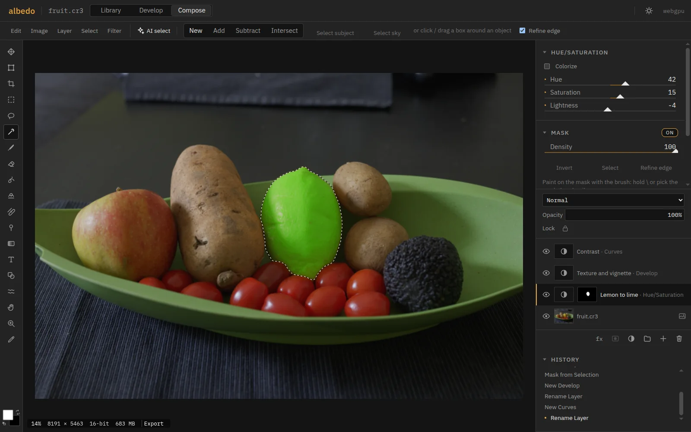

<p align="center"></p>

# albedo

A RAW developer and compositor that runs entirely in your browser.




<https://zahakj.github.io/albedo/app/>

```sh
git clone https://github.com/ZahakJ/albedo && cd albedo && npm install && npm run dev
```

`npm run setup-models` adds the AI models. `npm run build` writes a static site to `dist/`.

## Features

- Opens CR2, CR3, NEF, ARW, RAF (Bayer and X-Trans), ORF, RW2, PEF, DNG and the rest of LibRaw, plus JPEG and PNG.
- Develop runs on the GPU: 2.4 ms a frame on 24 MP, 2.3 ms on 45 MP with eight masks.
- A 45 MP RAW exports to full-resolution JPEG in 0.57 s.
- Masks: linear, radial, brush, and AI subject, sky, background or object. Subject in 93 ms.
- Remove, heal, clone and AI Denoise, all on your machine. Denoise does 45 MP in 3.8 s.
- Compose: layers with the RAW inside as a smart object, Develop and Photoshop-style adjustment layers, 27 blend modes, masks, groups, styles, 8, 16 or 32 bits.
- A 50-layer, 24 MP document redraws in 6.7 ms.
- Type shaped by HarfBuzz: Arabic and mixed-direction lines set right.
- Lightroom XMP sidecars and presets, and PSD, read and written. DNG and 16-bit TIFF out.
- Library: flags, ratings, albums, smart collections. A 10,000-photo catalog filters in 12–19 ms.
- Works offline once installed. No account, no upload.

Measured on an RTX 4070 SUPER in Chromium 151: [BENCHMARKS.md](docs/BENCHMARKS.md).

## Browser

WebGPU: Chrome or Edge 113+, Safari 26, Firefox 141+. On Linux, Chrome needs WebGPU switched on. Library and Develop fall back to WebGL2; Compose needs WebGPU.

## Docs

[Manual](https://zahakj.github.io/albedo/manual/) ·
[Architecture](docs/ARCHITECTURE.md) ·
[Pipeline](docs/PIPELINE.md) ·
[Catalog](docs/CATALOG.md) ·
[Presets and XMP](docs/PRESETS.md) ·
[Models](docs/MODELS.md) ·
[Benchmarks](docs/BENCHMARKS.md) ·
[The field](docs/COMPETITION.md) ·
[Limits](docs/RESOURCE-LIMITS.md) ·
[Development](docs/DEVELOPMENT.md)

## Licence

AGPL-3.0-only. Copyright (c) 2026 ZahakJ. Other terms are available from the copyright holder.

Bundled: LibRaw (CDDL-1.0 or LGPL-2.1, via libraw-wasm, with Little CMS), SQLite (public domain), onnxruntime-web (MIT), React (MIT), HarfBuzz (Old MIT, via harfbuzzjs), bidi-js (MIT), IBM Plex (OFL-1.1, `OFL.txt` beside each font), the lensfun database (CC BY-SA 3.0, `public/lensfun/LICENSE`). The AI models are fetched at setup under their own licences, listed in [MODELS.md](docs/MODELS.md). Sample photos are CC0 from [raw.pixls.us](https://raw.pixls.us).
